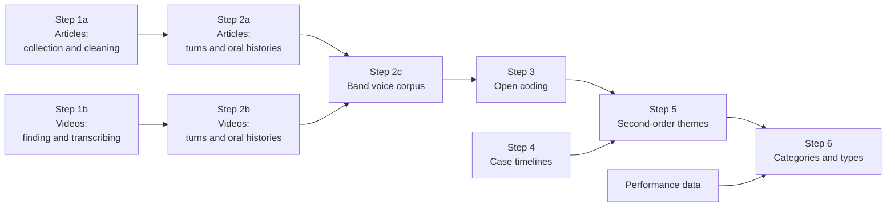

# Corpus construction and AI-agent analysis for a replication of Harrison, Askin and Hagtvedt (2023)

This repository holds the code for a replication of Harrison, Askin and Hagtvedt (2023), "Recognition Killed the Radio Star?", *Administrative Science Quarterly* 68(1), 97–145. It builds the interview corpus from open sources (Steps 1 and 2) and runs the analysis with three AI agents, from the open coding to the categories and types of acts (Steps 3 to 6). It also holds the checks made by hand that shaped the code. The technical appendix describes each step, the reasons for it and the checks made on it; this file says what each folder holds and how to run it.

The corpus covers the 52 acts nominated for the Grammy for Best New Artist from 1980 to 1990: the 55 nominees less Robin Williams, The Blues Brothers and Milli Vanilli, as in the paper. It has two sources, articles from the open web and YouTube videos. They are built separately and meet in the band voice corpus: for each act, every turn in which a member speaks in their own words, oldest first. That corpus is the input to the analysis.

## The steps at a glance

Step 1 collects the material, Step 2 turns it into speaking turns with a named speaker and a date, and Step 3 codes it. Step 4 sets each act's turns among the events of its career, Step 5 builds themes from the codes, and Step 6 groups the themes into broader categories, sorts the acts into types and compares the types' later careers. Steps 3 to 6 follow the steps of the guide of best practices that the agents read. Each folder is one step, and the folders sort in the order they run.

| Step | Folder | What it does | What it produces | Checked by hand |
|---|---|---|---|---|
| 1a | `Step 1a - Articles - collection and cleaning` | Searches the open web and the Wayback Machine for interviews with each act and its members, fetches the pages, and cleans and dates them | 13,993 article records, 9,316 of them in the turn set | the dates set from an "originally published" phrase (93 records), pages split into fragments (21), namesakes (1,125 records) |
| 1b | `Step 1b - Videos - finding and transcribing` | Finds interviews on YouTube, chooses them, downloads the audio, transcribes it (WhisperX) and labels the speakers (Gemini) | 615 transcribed videos | the choice of videos (237), the five videos with the worst sound, who speaks in two group interviews |
| 2a | `Step 2a - Articles - turns and oral histories` | Splits each article into speaking turns, names each speaker by rule, and orders each act's turns by date | 132,835 turns; one oral history per act | the format of 54 articles, the line-ups of the 30 groups, the name lists, and a validation on 21 held-out records |
| 2b | `Step 2b - Videos - turns and oral histories` | Joins the two transcripts into turns, keeps names only on evidence, and measures each turn's quality | 45,711 turns from 615 videos; one oral history per act | the joined turns against the two group interviews checked in Step 1b |
| 2c | `Step 2c - Band voice corpus` | Keeps every turn in which a member speaks in their own words, from the articles and the videos together | 29,717 turns in 52 files, one per act | 198 turns marked for a check |
| 3 | `Step 3 - Open coding` | Three AI agents read and open code the band voice corpus, each on its own, and write memos; a script merges their codes | each agent's codes and memo, and the merged codes | none |
| 4 | `Step 4 - Case timelines` | Sets each act's turns among the events of its career: its Best New Artist nomination and win, its studio albums, and its breakups and reunions | 537 events for the 52 acts; the timelines are made by the Step 5 script | none |
| 5 | `Step 5 - Second-order themes` | The three agents, each on its own, build themes act by act, then by comparing groups of acts, then into one list, and write memos; Agent A compares their work | each agent's final themes (27, 36 and 37) and memo, and the comparison | none |
| 6 | `Step 6 - Categories and types` | Each agent groups its themes into aggregate dimensions and types of act; the agents vote blind on a shared scheme; the script compares the agreed types' later careers, which each agent reads in a memo | a shared scheme of 15 dimensions and 12 types (and 2 types set aside), the tables and each agent's memo | none |

## How the code was built and checked

1. **Each step reads the files of the step before and writes new ones.** No script changes the files it reads. Several scripts check that those files are the versions they expect before they start, and print counts and a fingerprint of what they write, so a run can be compared with the counts in the technical appendix and the fingerprints below.
2. **Rules, not a language model, build the article turns.** Language models were used to check the rules blind, to tell who speaks in the videos (Gemini) and, from Step 3 on, for the analysis.
3. **Where a script makes a judgement, people checked it.** A sample, or every case, was checked by hand. Where the check found errors, the script was changed, and the hand decisions it applies are kept as data files. The checks are listed under [Checks by hand that shaped the code](#checks-by-hand-that-shaped-the-code), and the workbooks are in each step's `Hand checks` folder.
4. **Some checks were blind checks by AI agents**, run during development on records the rules had not been tuned on. The technical appendix reports them.
5. **The analysis scripts check every reply before accepting it.** In Steps 5 and 6, a reply goes back to its agent once if a quotation is not word for word in the corpus, a Turn ID or another ID it cites does not exist, or a part is missing or too long, and what remains is kept as a flag. Each round also records a fingerprint of the prompts, the guide and the data it started with, and will not carry on with other ones.
6. **Fingerprints of the final files.** A fingerprint is a short code that changes if any row changes, so a rebuild that prints the same code has produced the same rows:
   - article oral histories (`build_oral_histories.py`): rows `2ae21f4ea5423f143cba9d45e75a8d2b`, acts `92eb9a5a81dcd263a79eaedf3f56c67a`;
   - video oral histories (`build_video_oral_histories.py`): rows `eca1f4873a7307947c11000ccec0e801`;
   - band voice corpus (`build_band_voice_jsonl.py`): rows `b486395420de8353e320082337892df8`.

## What is in the repository

1. The scripts, in one folder for each step (see [Run order](#run-order)). Step 4 has no script: its folder holds the events file.
2. The hand decisions the scripts apply, as data files beside the scripts that read them: `body_context_dates_to_check.xlsx` (Step 1a), `checks.csv` (Step 1b) and `harrison_v7_band_voice_fixes.json` (Step 2c). The namesake review is written into `clean7_v7.py`, the name lists into the turn scripts, and the videos dropped after transcription into `gemini_speakers.py`.
3. The checks by hand, as workbooks in each step's `Hand checks` folder.
4. The tests of the turn rules, in `Step 2a - Articles - turns and oral histories/tests`.
5. The full rules for splitting the articles into turns, stage by stage, with their validation and known limits: `Step 2a - Articles - turns and oral histories/turn_level_methodology.pdf`.
6. The five prompts of the open coding, the list of turns it leaves out (`Step 3 - Open coding/step3_inputs`), and the guide of best practices that the agents read in Steps 3, 5 and 6 (`Step 3 - Open coding/best_practices_guide.pdf`).
7. The events of each act (`Step 4 - Case timelines/events_final.txt`), which Step 5 reads.
8. The seven prompts of Step 5 (`Step 5 - Second-order themes/step5_inputs`), and the three prompts of Step 6 with the performance data (`Step 6 - Categories and types/step6_inputs`).

The text of the articles and the transcripts of the videos are not in the repository, because they are copyrighted, and neither is any file the scripts write, including the agents' codes, themes and memos, which quote the corpus. For the same reason, the workbooks of hand checks leave out the columns that held the text: every row keeps its Record ID, Turn ID, video ID or link, so it can be checked against its source. The two interview passages that the coding prompt quotes from a methods book are not here either (see Step 3). Run from the start, the scripts collect the material again from the open web and write every file anew.

## What you need

1. Google Colab, with Google Drive mounted, for every Python script. Each script's header says how to run it and, where it needs one, gives its `pip install` line.
2. A local computer for the audio download (`get_audio.sh`), since YouTube refuses downloads from Colab, with [yt-dlp](https://github.com/yt-dlp/yt-dlp) and [Deno](https://deno.com) installed. yt-dlp uses Deno to run YouTube's JavaScript.
3. A Colab GPU runtime (A100, or L4) for `transcribe_videos.py`.
4. Six keys, stored in Colab Secrets with notebook access switched on. The scripts read them from there and never print them.
   1. `SERPER_API_KEY`, for the article and video searches ([Serper](https://serper.dev)).
   2. `YT_API_KEY`, for the YouTube Data API.
   3. `HF_TOKEN`, from a Hugging Face account that has accepted the user agreement of `pyannote/speaker-diarization-community-1`.
   4. `GEMINI_API_KEY`, for the speaker labels of the videos and for Agent B of Steps 3, 5 and 6.
   5. `ANTHROPIC_API_KEY`, for Agent A of Steps 3, 5 and 6.
   6. `OPENAI_API_KEY`, for Agent C of Steps 3, 5 and 6.

## Where the files go

The scripts read and write in two Drive folders:

1. `MyDrive/harrison_v7`: the scripts of Steps 1a, 2a, 2c, 3, 5 and 6, `video_links_v2.py`, `select_videos.py`, `select_videos_v2.py` and the data files, and everything these scripts write. Steps 3, 5 and 6 also read their prompts from `step3_inputs`, `step5_inputs` and `step6_inputs`, and each writes everything to a folder of its own, `step3_<RUN>`, `step5_<RUN>` and `step6_<RUN>` (for the full runs, `step3_full`, `step5_full` and `step6_full`).
2. `MyDrive/harrison_v7/Video for Harrison`: `transcribe_videos.py`, `gemini_speakers.py`, the scripts of Step 2b and `acts_frame.json`, with a copy of `harrison_v7_VIDEO_SELECTION.xlsx` and the audio files from `get_audio.sh`.

Several scripts take another folder through the `HARRISON_DIR` environment variable or a command-line argument; each header says how.

## Run order

The scripts run in the order of the numbers below. The article steps (1a, 2a) and the video steps (1b, 2b) do not depend on each other, and Step 2c needs both. Steps 3, 5 and 6 then run in order, each on the work of the one before.

### Step 1a. Articles: collection and cleaning

| # | Script | Reads | Writes |
|---|---|---|---|
| 1 | `harrison_corpus_v7.py`, run five times, with `BATCH = 1` to `5` | Serper, the Wayback Machine | `harrison_v7_batch1` to `batch5`; after the fifth batch, `harrison_v7_MERGED` |
| 2 | `dedupe_v7.py` | MERGED | `harrison_v7_DEDUPED` |
| 3 | `clean_dates_v7.py` | DEDUPED | `harrison_v7_DATED` |
| 4 | `clean_junk_v7.py` | DATED | `harrison_v7_CLEAN` |
| 5 | `clean_furniture_v7.py` | CLEAN | `harrison_v7_CLEAN2` |
| 6 | `apply_date_corrections.py` | CLEAN2, `body_context_dates_to_check.xlsx` | `harrison_v7_CLEAN4` |
| 7 | `finalise_v7.py` | CLEAN4 | `harrison_v7_CLEAN6` |
| 8 | `clean7_v7.py` | CLEAN6 | `harrison_v7_CLEAN7`, `harrison_v7_MEDIA_PAGES.xlsx` |

Each file is written twice: as `.json`, with the full text, which the next step reads, and as `.xlsx`, for reading (Excel cuts a cell at 32,767 characters). The collection takes about 4,500 Serper credits (1,498 queries, three pages each).

### Step 1b. Videos: finding and transcribing

| # | Script | Runs on | Reads | Writes |
|---|---|---|---|---|
| 9 | `video_links_v2.py` | Colab | Serper, the YouTube Data API | `harrison_v7_VIDEO_LINKS` |
| 10 | `select_videos_v2.py`, with `select_videos.py`, `video_links_v2.py` and `checks.csv` beside it | Colab or any computer | VIDEO_LINKS | `harrison_v7_VIDEO_SELECTION.xlsx`, `video_audio_list_all.txt`, `video_audio_list_pilot.txt` |
| 11 | `get_audio.sh` (`bash get_audio.sh pilot`, then `bash get_audio.sh all`) | a local computer | the audio lists | `video_audio/` |
| 12 | `transcribe_videos.py` | Colab, GPU | the selection, the audio | `video_transcripts/` |
| 13 | `gemini_speakers.py`, run twice: as it is, then with `--solo` | Colab | the selection, the transcripts, the YouTube links | `gemini_speakers/` |

The video search takes about 1,000 Serper credits and 5,300 of YouTube's 10,000 free daily units. On Gemini's free tier, `gemini_speakers.py` stops by itself before the day's allowance of video is used, and the same cell carries on the next day.

### Step 2a. Articles: turns and oral histories

| # | Script | Reads | Writes |
|---|---|---|---|
| 14 | `turns_v7.py` (stages 1 and 2) | CLEAN7 | `harrison_v7_TURNS_stage1`, `harrison_v7_TURNS_stage2` |
| 15 | `turns_v7_stage3.py` | CLEAN7, stages 1 and 2 | `harrison_v7_TURNS_stage3` |
| 16 | `turns_v7_stage4to9.py` | CLEAN7, stages 1 to 3 | `harrison_v7_turns_final`, `harrison_v7_spans_final`, `harrison_v7_records_final`, `harrison_v7_dashboard_final.xlsx` |
| 17 | `build_oral_histories.py` | the final tables, stage 1, CLEAN7, `harrison_v7_oral_histories_supplement.json` | `harrison_v7_oral_histories` |

After steps 15 and 16, `tests/s3_tests.py` and `tests/s49_tests.py` check the records named in the rules (68 and 45 checks).

The rules these scripts apply are set out stage by stage in `turn_level_methodology.pdf`, in this folder.

### Step 2b. Videos: turns and oral histories

| # | Script | Reads | Writes |
|---|---|---|---|
| 18 | `merge_video_turns.py` | both transcripts, the selection, `acts_frame.json` | `harrison_v7_VIDEO_TURNS`, `video_turns/` |
| 19 | `build_video_oral_histories.py` | VIDEO_TURNS, `acts_frame.json` | `harrison_v7_video_oral_histories` |
| 20 | `add_video_quality.py` | VIDEO_TURNS, `video_turns/`, the transcripts | the same files, ending in `_quality` |

### Step 2c. The band voice corpus

| # | Script | Reads | Writes |
|---|---|---|---|
| 21 | `build_band_voice_jsonl.py` | both oral histories, `harrison_v7_band_voice_fixes.json` | `band_voice_by_act/` (one `.jsonl` file per act), `harrison_v7_band_voice_corpus.xlsx`, `harrison_v7_band_voice_acts.json` |

### Step 3. Open coding

`step3_open_coding.py` runs the open coding with three AI agents, each on its own: Claude Opus 5.5 (Agent A), Gemini-4-Argon (Agent B) and GPT-6.1-Sol (Agent C). It reads the band voice corpus and `step3_inputs`, and never changes them. The models, their settings and their prices are set at the top of the script, and each call's prompt, reply and model version are saved with it.

Before the first run:

1. Copy `step3_inputs` to `MyDrive/harrison_v7/step3_inputs`.
2. In `prompt2.txt`, paste the two interview passages from Saldaña's *The Coding Manual for Qualitative Researchers* into the two `{paste here …}` slots, with their quotation marks: the high-school senior on someone close to him, and the mother on her son's years at school. They are left out for copyright, and the script will not start while a slot is empty.
3. Put the guide of best practices (`best_practices_guide.pdf`) in `step3_inputs` as a Word file, `best_practices_guide.docx`. The script reads the guide from Word, `.txt` or `.md` (set `GUIDE_FILE`), not from PDF, and gives the agents its text in full.
4. In Colab (any runtime): `!pip install -q "anthropic==2.3.0" "openai==3.37.0" "google-genai==2.33.0" tiktoken python-docx openpyxl`, then mount Drive and `%run -i "/content/drive/MyDrive/harrison_v7/step3_open_coding.py"`. For the full run, put `RUN = "full"; ACTS = "all"` on the line below; the defaults run the pilot act, Big Country.

Then, in this order:

| # | Call | What it does | Writes |
|---|---|---|---|
| 22 | `check_inputs()`, `dry_run()`, `test_models()` | checks the corpus, the prompts, the guide, the keys and the packages; writes the filled prompts, to read before spending anything; makes a few small calls to each model | `step3_<RUN>/dry_run/` |
| 23 | `run_round1()` | round 1: each agent reads every act in full and writes notes and data problems, sent as batches at half price; run it again until all three agents say "round 1 done" | `step3_<RUN>/agent_A`, `agent_B`, `agent_C` (`reading/`) |
| 24 | `make_exclusion_list()` | lists the turns that two or more agents marked as not the member's words, which round 2 leaves out | `step3_inputs/excluded_turns.csv`, `step3_<RUN>/reports/exclusion_candidates.csv` |
| 25 | `run_round2(part=1)`, then `part=2` and `part=3` | round 2: each agent codes the acts in nomination-year order and reviews each act once it is coded; three parts of about a third of the turns each (`show_parts()` lists them) | each agent's `batches/`, `codes/`, `reviews/` and `memory.txt`; `step3_<RUN>/reports/act_reports.jsonl` |
| 26 | `run_round3()` | round 3: part 1 of each agent's memo | each agent's `memo_part1.md` |
| 27 | `run_round4()` | round 4: merges the three agents' codes, turn by turn, and works out the agreement figures and the sample of turns for round 5 | `step3_<RUN>/merged/` |
| 28 | `run_round5()` | round 5: parts 2 and 3 of each agent's memo | each agent's `memo_parts2and3.md` and `memo_<letter>.md` |

`status()` shows where each agent is, its cost and its flags at any time, and `pilot_report()` projects the cost and hours of round 2 from a pilot. The run stops when the three agents' cost passes `BUDGET_USD`.

Every accepted reply is saved as its own file, so a run that stops (Colab disconnects, Stop is pressed, the budget runs out) carries on where it left off when the same cell is run again, and nothing is coded twice or left out. To stop, press Stop once and wait for the calls in progress to finish.

`step3_inputs/excluded_turns.csv` is the list of the study's full run: 370 turns, with the agents' reasons shortened, since they quote the corpus. To leave out the same turns, keep this file and skip `make_exclusion_list()`, which adds to the list rather than replacing it. To change the list, use `remove_from_exclusion_list()` and `add_to_exclusion_list()` rather than a spreadsheet, which can turn Turn IDs such as 32-2 into dates.

### Step 4. Case timelines

`events_final.txt` holds the events of each act's career that the analysis is timed against: its Best New Artist nomination (52) and win (10), its studio albums (405), and its breakups (40) and reunions (30), 537 events in all. Each event has its date, the precision of that date, its sources and whether they settle it (486 events) or leave it uncertain (51). The events were compiled from public sources, mostly Wikipedia (the main source of 437 events) and the Recording Academy's pages. There is no script for this step: the timelines are made by the Step 5 script (`run_timelines()`), which places each act's turns among its events in date order.

### Step 5. Second-order themes

`step5_themes.py` runs Step 5 with the same three agents, each working on its own from its own Step 3 codes, memo and memory. Each agent keeps a running memo, its memory as Step 3 left it, which rounds 1 to 4 update and Step 6 starts from. Agent A is also the lead, who compares the three agents' work at the end. No round reconciles the three agents' themes, and the performance data of Step 6 is not used. The script reads the band voice corpus, `step3_inputs`, Step 3's run folder and `step5_inputs`, and never changes them.

Before the first run:

1. Copy `step5_inputs` to `MyDrive/harrison_v7/step5_inputs`, and put `events_final.txt` from `Step 4 - Case timelines` in it.
2. Leave Step 3's run folder (`step3_full`) and `step3_inputs`, with the guide as `best_practices_guide.docx`, where Step 3 left them.
3. In Colab (any runtime), install the same packages as for Step 3, then mount Drive and `%run -i "/content/drive/MyDrive/harrison_v7/step5_themes.py"`. For the full run, put `RUN = "full"; ACTS = "all"` on the line below, with `BUDGET_USD` set from the pilot's projection; the defaults run a pilot on eight acts.

Then, in this order (`run_all()` runs rounds 0 to 8 in one go):

| # | Call | What it does | Writes |
|---|---|---|---|
| 29 | `check_inputs()`, `dry_run()`, `test_models()` | as in Step 3, with Step 3's work and the events | `step5_<RUN>/dry_run/` |
| 30 | `run_timelines()` | round 0, no model calls: each act's events and turns in date order, with each turn's period (before, around or after the ceremony) and its days since each event | `step5_<RUN>/timelines/` |
| 31 | `run_within()` | round 1: each agent studies each act on its own, drafts the act's themes and writes a summary of about 300 words | each agent's `within/` |
| 32 | `run_groupings()` | round 2: from the summaries, each agent sets up its own ways of sorting the acts into groups, at least two and none on outcomes such as breakups or later success | each agent's `groupings.json` |
| 33 | `run_comparisons()` | round 3: one call per grouping; the agent compares the acts within and across its groups and drafts themes | each agent's `comparison_<n>.json` |
| 34 | `run_final()` | round 4: each agent brings its themes together into one list and records every merge, split and change of scope | each agent's `final.json` |
| 35 | `run_memo1()` | round 5: part 1 of each agent's memo, before it sees the others' work | each agent's `memo_part1.md` |
| 36 | `run_merge()` | round 6, no model calls: the three agents' work in one workbook, without changing or resolving anything, and where their final themes draw on the same turns | `step5_<RUN>/merged/` |
| 37 | `run_lead()` | round 7: Agent A compares the three agents' groupings and themes, without choosing between them | `merged/comparison_by_lead.md` |
| 38 | `run_memo23()` | round 8: parts 2 and 3 of each agent's memo, after reading the comparison | each agent's `memo_parts2and3.md` and `memo_<letter>.md` |

`pilot_report()` writes a report of the run to `reports/pilot_report.md`, with the cost and hours of a full run projected from it. `status()`, the budget and the saving work as in Step 3.

### Step 6. Categories and types

`step6_categories.py` runs Step 6 with the same three agents, each starting from its own Step 5 work, in three rounds. In every round the agents work side by side, each in calls of its own: no agent passes its work to another, and the script does the pooling and the counting between rounds. The script reads the band voice corpus, `step3_inputs`, the run folders of Steps 3 and 5, and `step6_inputs`, and never changes them.

Before the first run:

1. Copy `step6_inputs` to `MyDrive/harrison_v7/step6_inputs`. Besides the three prompts, it holds `dv_performance_data.xlsx`, the performance data: for each act, its studio albums with their Billboard 200 peaks and RIAA certifications, its later Grammy nominations and wins, and its years active, each from the public source the file gives.
2. Leave the run folders of Steps 3 and 5 where they are. `STEP5_RUN` names the Step 5 run to start from, and Step 6 covers that run's acts.
3. In Colab (any runtime), install the same packages, then mount Drive and `%run -i "/content/drive/MyDrive/harrison_v7/step6_categories.py"`. The defaults, `RUN = "full"` and `STEP5_RUN = "full"`, run Step 6 on the full run of Step 5.

Then, in this order (`run_all()` runs rounds 1 to 3 and the merge in one go):

| # | Call | What it does | Writes |
|---|---|---|---|
| 39 | `check_inputs()`, `dry_run()`, `test_models()` | as in Step 5, with Step 5's work and the performance data | `step6_<RUN>/dry_run/` |
| 40 | `run_own()` | round 1: each agent, on its own, groups its final themes into aggregate dimensions, builds types of act from them and places every act, with its evidence; it sees no other agent's work and no performance data | each agent's `own.json` |
| 41 | `run_vote()` | round 2: the script pools the three agents' dimensions and types into one list, in a neutral order and without their authors; each agent marks every item keep, drop or the same as another, backs what it keeps with its own themes or acts, and says whether each type rests on what round 3 measures | `merged/pool.json`, each agent's `votes.json` |
| 42 | `run_careers()` | round 3: the script counts the votes into the shared scheme and tabulates the performance data for the acts in each agreed type against the other acts; each agent reads the tables, without changing the scheme, and writes its memo | `merged/shared_scheme.json` and `.txt`, `merged/performance_tables.txt` and two CSV files, each agent's `memo6.md` |
| 43 | `run_merge()` | no model calls: every round's work in one workbook, and the three memos in one file, after the shared scheme's definitions and before the tables | `merged/step6_combined.xlsx`, `merged/step6_memos.md` |

The count follows fixed rules, set at the top of the script (`AGREE = 2`, `MIN_TYPE_ACTS = 3`). Two items count as one when at least two agents mark them the same. An agent backs an item only with evidence from its own work, at least one of its themes for a dimension and at least three acts that fit it for a type, and marking an item the same as another counts as keeping both, as one. An item stands when at least two agents back it, and an act stands in a type when at least two of the type's backers place it there; a type needs at least three such acts. A type that at least two agents judge to rest on what round 3 measures (splits, returns, stops, longevity, output or later success) is kept on record but left out of the tables, since comparing it would be circular, and a type that leaves fewer than three acts outside it is kept apart as a pattern that nearly every act shows. Everything else is kept on record as a disagreement.

`report()` writes `reports/step6_report.md`: what each round produced, how far the agents agreed, and the cost. `status()`, the budget and the saving work as in Step 3.

## Checks by hand that shaped the code

Each row is a check made by a person, what it changed, and where its record is. Paths are within the step's folder.

| Step | What was checked by hand | What it changed | File |
|---|---|---|---|
| 1a | 93 records dated from an "originally published" phrase, each checked against its source | 81 dates corrected and 12 cleared; wrong-entity pages and index pages rejected; replacement articles added | `body_context_dates_to_check.xlsx`, read by `apply_date_corrections.py` |
| 1a | 21 pages the collection script had split into fragments | 15 merged and 6 rejected. The splitter also cut long single interviews into pieces, so it was switched off: the collection script now keeps such pages whole and flags them (`SEGMENT_AGGREGATES = False`) | `Hand checks/segment_review.xlsx` |
| 1a | 1,125 records in which the name of an act or a member might mean someone or something else | the decisions are written into `clean7_v7.py`, which keeps namesakes and other senses of a name out of the turn set | `Hand checks/namesake_review.xlsx` |
| 1b | 237 chosen videos: every title, and the description wherever the date or the speaker was in doubt | 70 rows dropped (re-uploads and videos that did not fit the rule), 72 dates corrected or added, 95 videos marked as banter and 10 missed videos added | `checks.csv`, read by `select_videos_v2.py` |
| 1b | the five videos with the worst sound, transcribed and checked by ear | the rule for sung parts in `transcribe_videos.py` was changed | none (the check was by ear) |
| 1b | who says each sentence of two group interviews with poor sound (94 sentences), decided while watching them | WhisperX, Gemini and AssemblyAI were scored against it: WhisperX gives the words and Gemini the speakers, with names only on evidence | `Hand checks/speaker_check_V1158_V1319.xlsx`, `Hand checks/speaker_test_results.xlsx` |
| 2a | the format of 54 articles (labelled Q&A, unlabelled Q&A, first-person account or prose) and where each interview starts, from the first version of stage 2 | version 2 of `turns_v7.py`: the formats agree with the check in 45 of 54 records (41 before), and all 9 misplaced block starts are fixed | `Hand checks/routing_review.xlsx` |
| 2a | the line-ups of the 30 groups and duos at their nomination (23 decisions) | the nomination-era and other-era members in the name lists | `Hand checks/lineup_review.xlsx` |
| 2a | the name lists: pronouns, aliases, non-members who share a name, a stoplist and Q&A labels | the lists written into `turns_v7_stage3.py` and `turns_v7_stage4to9.py`, and two rules: a label counts as a member only where the record names that member in full, and a name shared across eras counts only when an earlier full name settles it | `Hand checks/name_lists_review.xlsx` |
| 2a | 21 held-out records, coded by hand character by character before any of the script's output was seen | measures the rules: band voice precision 96.4% and recall 82.9%, with the right member every time. The misses were not fixed, so the records never informed the rules | `Hand checks/validation_results.xlsx` |
| 2b | the joined video turns against the two group interviews checked in Step 1b | 84% of sentences right, 51 of 55 speaker changes found, band voice precision 94% and recall 98% | the Step 1b workbooks |
| 2c | 198 turns marked for a check: possible page furniture and editors' notes, video turns in Gemini's own words, and re-uploads that carry another year | 40 turns cut, 4 dropped, the dates of 7 videos checked | `harrison_v7_band_voice_fixes.json`, read by `build_band_voice_jsonl.py` |

## The numbering of the files

There is no CLEAN3, CLEAN5 or VERIFIED file. They came from repairs made once to the corpus collected for this study, which the scripts here no longer need.

1. CLEAN3 came from a repair of pages that the collection script had split into pieces (the segment check above). The collection script now keeps such pages whole and flags them (`SEGMENT_AGGREGATES = False`).
2. CLEAN5 added one article that was found late.
3. VERIFIED came from a second fetch of every page, to read the date the page states in its own metadata. The collection script now records that date when it first fetches the page, and `clean_dates_v7.py` applies the check, so DATED here is what VERIFIED was in the study's run.
4. The five batches were merged by a separate script. The collection script now merges them after the fifth batch.
5. 86 videos first came down with a YouTube AI-dubbed track and were downloaded again. `get_audio.sh` now takes the original track first.

The other file names are kept, so that they match the technical appendix.

## On a newly collected corpus

A new run collects a different set of pages and videos. The hand decisions were made on the corpus collected for this study, and several checks guard its published figures, so:

1. `apply_date_corrections.py` matches each hand-checked date on the act and the URL; rows with no match are reported and skipped.
2. `clean7_v7.py` and the three turn scripts stop. `clean7_v7.py` identifies the records of the namesake review by record ID and a fingerprint of each URL, and the turn scripts check the record count, the turn set and its fingerprint, and the fingerprints of the earlier stages' files.
3. `checks.csv` and the list of dropped videos in `gemini_speakers.py` are keyed by V IDs, which a new search gives to other videos. Leave `checks.csv` out of the folder, and empty `DROPPED`, before such a run.
4. `harrison_v7_band_voice_fixes.json` is keyed by turn and video IDs. Set `APPLY_FIXES = False` in `build_band_voice_jsonl.py` before such a run.
5. `build_oral_histories.py` needs `harrison_v7_oral_histories_supplement.json`, which holds the text of published interviews added by hand and is not in the repository; without it the script stops.
6. `excluded_turns.csv` in `Step 3 - Open coding/step3_inputs` is keyed by Turn IDs. Leave it out of `step3_inputs` before such a run, and make the list with `make_exclusion_list()` after round 1.
7. `events_final.txt` (Step 4) and `dv_performance_data.xlsx` (Step 6) describe the acts, not the corpus, so they serve a new run as they are.
